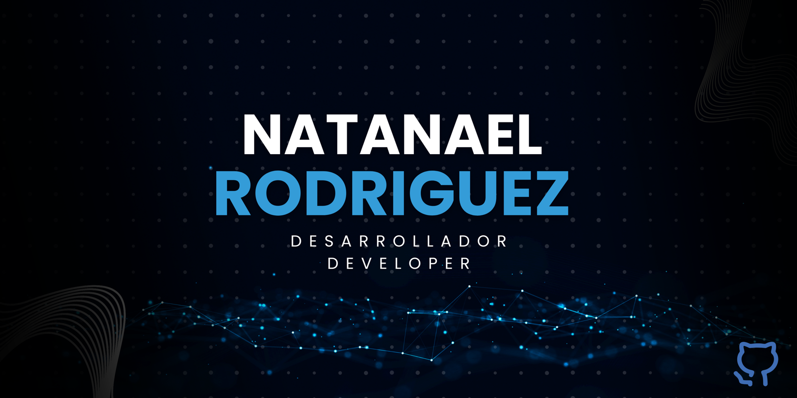

<div align="center">
  
</div>

# 📜 Políticas de Privacidad

Repositorio público con las políticas de privacidad de las aplicaciones
desarrolladas por **[@natanaelr16](https://github.com/natanaelr16)**.

Cada app publicada tiene su propio documento, redactado en lenguaje claro y
actualizado conforme evolucionan sus funciones y la normativa aplicable.

---

## 📱 Aplicaciones


**TurnosApp** permite registrar turnos laborales y estimar pagos en Colombia.

| App | Plataformas | Política de privacidad |
|-----|:-----------:|:----------------------:|
| **TurnosApp** | iOS · Android | [📄 Ver política](turnosapp/POLITICA_PRIVACIDAD.md) |

---

## 🔒 Privacidad en TurnosApp


TurnosApp guarda los datos de uso en tu dispositivo, sin cuentas, servidores,
analítica ni publicidad. Los respaldos PDF se generan localmente y tú decides
dónde guardarlos o con quién compartirlos.

Consulta su política para conocer los detalles sobre almacenamiento,
eliminación de datos y el marco legal aplicable.

---

## 🔄 Actualizaciones

Cada política indica su fecha de última actualización. Los cambios anteriores
pueden consultarse en el historial de Git del documento correspondiente.

## 📂 Estructura del repositorio

Cada aplicación tiene su propia carpeta. Las futuras apps de @natanaelr16 se
publicarán aquí con el mismo formato.

```text
Politicas-de-privacidad/
├── README.md
├── banner.png
├── turnosapp/
│   └── POLITICA_PRIVACIDAD.md
└── <proxima-app>/           # una carpeta por cada app futura
    └── POLITICA_PRIVACIDAD.md
```

## 💬 Contacto

¿Encontraste un error o tienes una pregunta general? Abre una
[consulta pública en GitHub](https://github.com/natanaelr16/Politicas-de-privacidad/issues).
No incluyas datos personales, información salarial ni respaldos PDF.

---

<div align="center">
  <sub>Este repositorio publica las políticas de privacidad de las aplicaciones de
  @natanaelr16. Cada documento describe únicamente la aplicación indicada.</sub>
</div>
